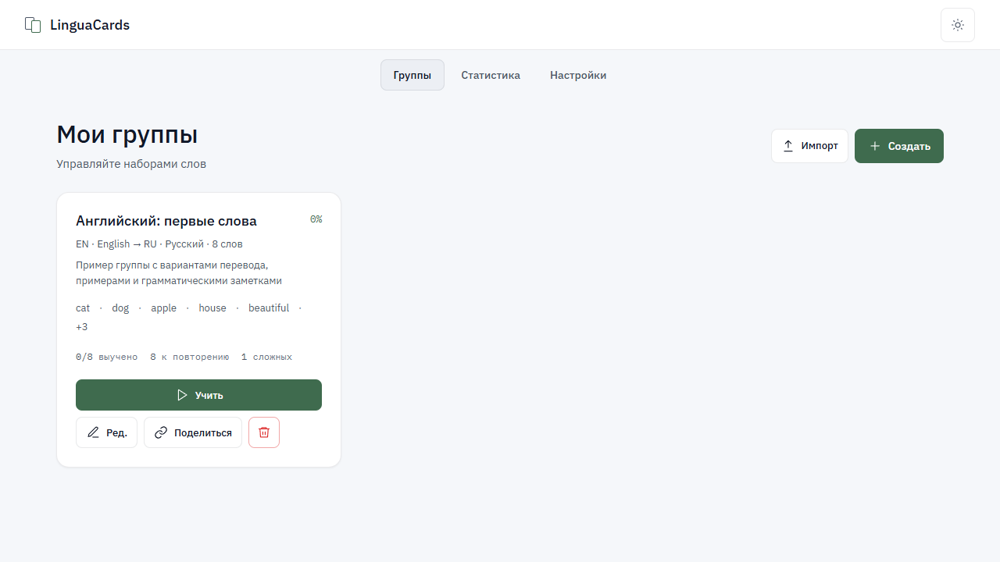

# LinguaCards

Сайт на Vanilla JS для изучения иностранных слов: карточки, тесты, строгие диктанты и повторение сложных слов. Группы и статистика хранятся локально в браузере.



## Возможности

- группы слов с описанием и выбором языков;
- добавление по одному слову или массовым списком;
- локальный перевод через Transformers.js и OPUS-MT;
- опциональный онлайн-перевод MyMemory с предупреждением о качестве и лимитах;
- режимы «слово → перевод», «перевод → слово», флеш-карточки и тест;
- строгий диктант без засчитывания опечаток;
- отдельный результат «почти верно» при включённой мягкой проверке;
- несколько допустимых слов и переводов для одной карточки;
- примеры предложений и грамматические заметки;
- повторная выдача ошибочных карточек и отдельное повторение ошибок;
- прогресс и срок следующего повторения для каждого слова;
- статистика по сессиям и группам с единой формулой точности;
- экспорт и восстановление JSON с проверкой данных;
- передача групп через код без внешнего сервера;
- тёмная и светлая темы, пять языков интерфейса;
- адаптивный интерфейс, клавиатурная навигация и поддержка reduced motion.

Произношение через `speechSynthesis` намеренно не добавлено: эту функцию лучше спроектировать отдельно с учётом голосов и языков устройства.

## Запуск

Сборка и установка пакетов не нужны. Для полноценной работы Web Worker и локального перевода запускайте сайт по HTTP(S), например:

```bash
python -m http.server 8000
```

Затем откройте <http://localhost:8000>. GitHub Pages также предоставляет необходимый HTTPS-контекст.

При первом запуске приложение предлагает выбрать языки по умолчанию и способ перевода. Примерную группу «Английский: первые слова» можно редактировать или удалить. Если групп нет, пример можно добавить повторно кнопкой на пустом экране.

## Перевод

Автоматический перевод всегда остаётся редактируемым черновиком. Перед сохранением группы результат нужно проверить. Доступны три режима.

### На устройстве

- Используется Transformers.js `4.3.2` и квантованные `q8`-модели OPUS-MT из статического списка проверенных направлений.
- Модель скачивается с Hugging Face только после явного выбора локального режима: по кнопке загрузки или при первом переводе.
- Текст перевода не отправляется на сервер. Сеть нужна для скачивания библиотеки и модели.
- Одна модель обычно занимает около 100–130 МБ. Для некоторых пар используются две модели через английский.
- Вычисления выполняются в Web Worker: WebGPU при поддержке устройства, иначе WASM.
- В памяти остаётся одна активная модель. Массовый перевод выполняется последовательно, чтобы ограничить нагрузку.
- Скачанные модели кэшируются браузером и не входят в JSON-резервную копию. Их можно удалить отдельной кнопкой в настройках.

Для непроверенных направлений приложение не подставляет фиктивную модель: остаются ручной ввод и явно включённый MyMemory.

### MyMemory

MyMemory включается только по выбору пользователя и не становится автоматическим fallback после ошибки локальной модели.

- Текст отправляется на сторонний сервер `api.mymemory.translated.net`.
- Качество перевода может быть низким или нестабильным, результат особенно важно проверять.
- Анонимный документированный лимит — 5000 символов в день. Один запрос ограничен 500 байтами UTF-8.
- В настройках показывается локальная оценка остатка по отправленным приложением символам.
- MyMemory не возвращает точный остаток. Фактический лимит может отличаться и быть общим для IP-адреса, поэтому локальная оценка не представляется серверным значением.

### Ручной ввод

Можно полностью отключить автоматический перевод. Все остальные функции приложения продолжат работать без загрузки моделей и сторонних запросов.

## Данные и приватность

Группы, настройки, статистика и прогресс хранятся в `localStorage` под ключом `lc3_data`. Данные предыдущей версии автоматически мигрируют в новый формат.

Перед большими изменениями или очисткой браузера скачайте резервную копию: **Настройки → Данные → Скачать**. Восстановление проверяет структуру файла и требует подтверждения замены текущих данных.

Локальный перевод не отправляет слова на сервер; MyMemory отправляет их только при явном использовании этого режима.

## Массовый ввод

Поддерживаются строки вида:

```text
apple - яблоко
cat : кошка
dog — собака
house=дом
school	школа
beautiful
```

В последнем случае перевод можно заполнить вручную или нажать «Перевести всё». Слова из списка добавляются к карточкам, введённым по одному; дубликаты иностранных слов пропускаются.

Допустимые варианты, пример и грамматическая заметка редактируются в раскрывающемся блоке карточки. Несколько вариантов разделяются точкой с запятой.

## Повторение и оценивание

Правильный ответ повышает уровень слова и откладывает следующее повторение на 1, 2, 4, 7 или 16 дней. Ошибка сбрасывает уровень, а «почти верно» понижает его. Ошибочные карточки один раз возвращаются в конец текущей сессии.

Слово считается выученным начиная с третьего уровня. В настройках запуска можно выбрать только срочные карточки или поставить их первыми.

Точность рассчитывается одинаково во всех разделах:

```text
правильные / (правильные + почти + ошибки + пропуски) × 100%
```

## Тесты

Откройте `tests.html` через локальный сервер. Страница запускает тесты без тестовых библиотек и показывает результат каждой проверки.

Покрываются массовый ввод, сравнение ответов, диктант, генерация теста, переворот карточек, статистика, повторения, миграция настроек, маршруты локальных моделей, оценка лимита MyMemory, импорт и экспорт.

## Файлы

- `index.html` — разметка страниц и диалогов;
- `styles.css` — темы, адаптивность и доступные состояния;
- `app.js` — интерфейс, хранение, обучение и выбор перевода;
- `core.js` — модель данных и чистые функции;
- `translation-models.js` — проверенные модели и маршруты;
- `translation.js` — очередь локального перевода и клиент MyMemory;
- `translation.worker.js` — загрузка ONNX-моделей и инференс;
- `icons.js` — локальные SVG-иконки Lucide;
- `tests.html`, `tests.js` — браузерные автоматические тесты.

## Дизайн

Интерфейс доработан по методике [unslop](https://github.com/heydamir/unslop) Дамира Соколовского ([@heydamir](https://x.com/heydamir)), CC BY 4.0. Иконки — [Lucide](https://lucide.dev), ISC.
